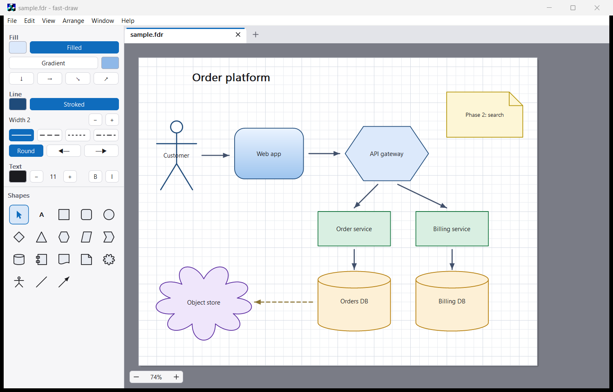

# fast-draw

[](https://github.com/ZacWalk/fast-draw/actions/workflows/build.yml)

A small, fast vector drawing program for Windows, aimed at system architecture
diagrams and quick sketches. A plain Win32 SDK application in C++20 with its own
anti-aliased software renderer — no UI framework and no common controls: the tab
strip, sidebar, shape palette and colour picker are all drawn by the app itself.

Back in the late 1990s and early 2000s I worked on a Windows application to draw
business process diagrams at a company called Casewise. It was cool because you
could run simulations on the diagrams and see what happened if you fired the van
driver, for example. At the time I was fascinated by the Microsoft DrawCli
sample, a simple drawing tool. Several other people on the internet extended it,
and I subsequently extended their work. Anyway, I have pulled it off my backup CD
from 2005 and got it building again.



## What it does

- **Shapes for diagrams** — rectangle, rounded, ellipse, decision, triangle,
  service, data, stage, database, component, document, note, cloud, actor, line
  and arrow. Click one in the palette and click or drag on the page, or drag it
  straight out of the palette.
- **Styling from the sidebar** — fill, linear gradient and direction, line
  colour, width, dash, arrow heads, and text colour, size and weight. Editing one
  control leaves the rest of a mixed selection alone.
- **Labels** — double-click or press <kbd>F2</kbd> to type directly on a shape.
- **Undo/redo, snapping and zoom** — full history, snap to a 0.25" grid
  (<kbd>Alt</kbd> to override), zoom from 10% to 800%.
- **Files** — documents are readable JSON (`.fdr`). Export to PNG, or print.

## Building

Requires Windows x64 and Visual Studio with the Desktop C++ workload. The
vendored [dd](https://github.com/ZacWalk/dd) runtime locates Visual Studio and
uses the CMake and Ninja that ship with it. zlib and libpng are fetched
automatically.

```powershell
.\dd.ps1 build        # both configurations
.\dd.ps1 test         # build and run the suite
.\dd.ps1 launch       # build Release, then start the app
```

## Credits

The drawing code descends from the Microsoft DrawCli sample by way of JTDraw, an
MFC application by Tao Zhu and Jian Zhu. It has since been rebuilt as a Win32 SDK
application with a CMake build, its own renderer and a test suite.

## Documentation

[AGENTS.md](AGENTS.md) — conventions for contributors and coding agents.

## License

[MIT](LICENSE)
