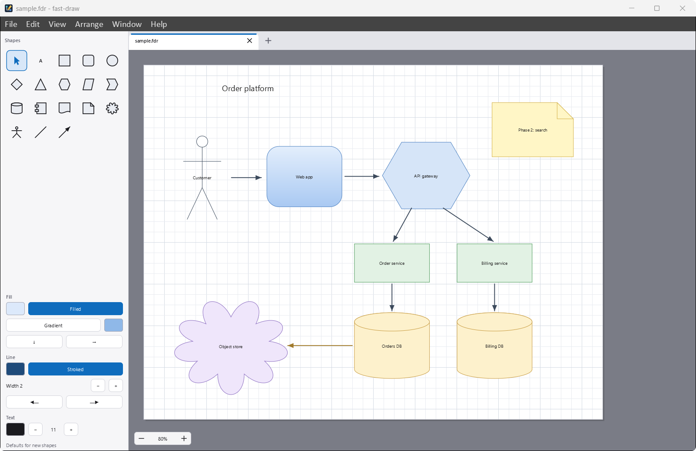

# fast-draw

[](https://github.com/ZacWalk/fast-draw/actions/workflows/build.yml)

A small, fast vector drawing program for Windows, aimed at system architecture
diagrams and quick sketches. A C++20 application on
[libdesktop](https://github.com/ZacWalk/libdesktop): shapes are drawn as
libdesktop polygons, filled, bordered and shaded, and the tab strip, sidebar,
shape palette and colour controls are app-owned drawing through the same draw
context.



## What it does

- **Shapes for diagrams** — rectangle, rounded, ellipse, decision, triangle,
  service, data, stage, database, component, document, note, cloud, actor, line
  and arrow. Click one in the palette and click or drag on the page, or drag it
  straight out of the palette.
- **Styling from the sidebar** — fill, a top-to-bottom or left-to-right
  gradient, line colour and width, arrow heads, and text colour and size.
  Editing one control leaves the rest of a mixed selection alone.
- **Labels** — double-click or press <kbd>F2</kbd> to type directly on a shape.
- **Undo/redo, snapping and zoom** — up to 128 undo steps, snap to a 0.25" grid
  (<kbd>Alt</kbd> to override), zoom from 10% to 800%.
- **Files** — documents are readable JSON (`.fdr`). Export to PNG, or print.

## Building

Requires Windows x64 and Visual Studio with the Desktop C++ workload. The
vendored [dd](https://github.com/ZacWalk/dd) runtime locates Visual Studio and
uses the CMake and Ninja that ship with it. libdesktop and
[libfiles](https://github.com/ZacWalk/libfiles) are fetched at their pinned
revisions, or taken from sibling `..\libdesktop` and `..\libfiles` checkouts;
libfiles builds only the PNG codec fast-draw needs.

```powershell
.\dd.ps1 build                   # both configurations
.\dd.ps1 test --label fast-draw  # build and run the suite
.\dd.ps1 test --label headless   # the same gate, no visible UI, console case/check counts
.\dd.ps1 launch                  # build Release, then start the app
```

An unfiltered `.\dd.ps1 test` also starts the app to check that its window
opens and closes.

Both labels retain the complete suite and print its actual counts, even on
success. After building,
`ctest --preset x64-debug -L headless -V --no-tests=error` reruns it without
rebuilding; use `x64-release` for Release.

### Icon

`python tools\generate_icon.py` regenerates `src\res\fast-draw.ico` from
the pen-and-diagram vectors, in nine desktop sizes. Add `--check` to verify
without writing, or `--output tmp\icon-128.png --size 128` for another size.
Python 3.9+'s standard library and the vendored `tools\iconlib.py` are sufficient;
no sibling checkout or graphics package is required.

## Credits

The drawing code descends from the Microsoft DrawCli sample by way of JTDraw, an
MFC application by Tao Zhu and Jian Zhu.

## Documentation

[AGENTS.md](AGENTS.md) — conventions for contributors and coding agents.

## License

[MIT](LICENSE). The executable includes
[libdesktop](https://github.com/ZacWalk/libdesktop) and
[libfiles](https://github.com/ZacWalk/libfiles), which are licensed under the
Mozilla Public License 2.0: anyone distributing the executable must tell its
recipients where to get their source code, including any changes made to it.
`tools/iconlib.py` is vendored from libdesktop under the same licence.
